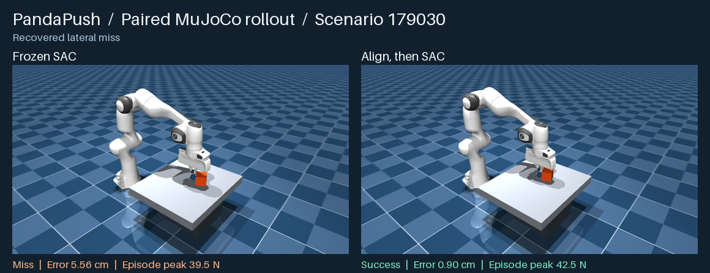

# PandaPush

**Contact-rich object pushing with Franka Panda, MuJoCo, and SAC.**

PandaPush 是一个具身智能实验项目。Franka Panda 用腕部推动球把方块推入目标区。SAC 输出三维末端位移，Jacobian IK 和位置伺服驱动七个关节，方块位移由 MuJoCo 的真实接触求解产生。成功要求在 60 步回合结束时，方块中心连续至少 3 步距目标小于 3 cm。

[](media/mujoco_comparison.mp4)

[观看 13 秒 MuJoCo 演示](media/mujoco_comparison.mp4) · [实验报告](docs/experiment_report.md) · [算法中文笔记](docs/algorithm_notes.md) · [复现命令](REPRODUCTION.md)

## 跑一次 MuJoCo 演示

已在 Windows、Python 3.12、MuJoCo 3.4.0 和 PyTorch 2.7.1 CPU 上验证。从仓库根目录打开 PowerShell。

```powershell
uv venv --python 3.12 .venv
uv pip sync --python .venv/Scripts/python.exe --index 'https://download.pytorch.org/whl/cpu' --index-strategy unsafe-best-match requirements-lock.txt
& .\.venv\Scripts\python.exe -m panda_push.demo --viewer aligned_handoff --seed 179030
```

把 `aligned_handoff` 改成 `baseline` 可以重放相同物理条件下的冻结 SAC。运行下面的命令可重新生成视频和截图，并检查回放是否与归档结果一致。

```powershell
& .\.venv\Scripts\python.exe -m panda_push.demo --output repro/demo
& .\.venv\Scripts\python.exe -m pytest -q
```

场景 `179030` 展示主动对齐如何挽回一次横向推偏。场景 `180091` 展示主动对齐候选出现最高接触力的回合。两个场景分别配对比较，同一场景内两个方案加载相同检查点。

## 主要实验结果

- **学习基线。** 种子 11 的 50,000 步稠密 SAC 在名义物理的 100 个独立场景达到 96% 成功率。相同 10,000 步预算的三种子对照中，原始稀疏 SAC 平均成功率 3.0%，稀疏 SAC + HER 为 18.3%。安全终止代价修正和独立重测详见报告。
- **组合物理变化。** 固定种子 29 的 90,000 步检查点，在首次接触前主动对齐再交给 SAC，两个新的 128 场景批次分别实现 98.44% 和 99.22% 成功率。下表为两批的配对汇总。

| 指标 | 冻结 SAC | 主动对齐后交给 SAC |
| --- | ---: | ---: |
| 成功率 | 240/256（93.75%） | 253/256（98.83%） |
| 平均绝对末横向误差 | 1.144 cm | 0.552 cm |
| 1 cm / 2 cm 到位率 | 26.95% / 58.98% | 39.45% / 80.86% |
| 平均回合力峰 / P95 | 39.45 / 51.71 N | 40.42 / 50.97 N |
| 单次最高力 | 58.67 N | 69.34 N |
| 安全终止 | 0/256 | 0/256 |

主动对齐满足成功率、横向误差和精度目标。平均力峰和最高力上升，因此冻结 SAC 仍是最终参照。 [最新逐回合配对](results/success_seed29/aligned_handoff_ablation/paired_outcomes.csv) · [逐项验收](results/success_seed29/aligned_handoff_ablation/acceptance.csv)

## 目录与归档

| 路径 | 内容 |
| --- | --- |
| `panda_push/` | Gymnasium 环境、IK/伺服、SAC/HER 训练和评估 |
| `models/franka_emika_panda/` | Panda MJCF、网格和 PandaPush 场景 |
| `configs/`、`scripts/`、`tests/` | 实验设置、运行脚本和验证测试 |
| `docs/`、`results/` | 完整报告、报告引用的数据和图、选定检查点及最新配对原始回合 |
| `media/` | 可直接观看的 MuJoCo 视频和预览 |

上传目录包含演示和最新两批对照所需的检查点与配置。历史实验的完整训练日志、旧中间产物和回放缓冲保存在本地原项目。历史续训可使用原缓冲，或按复现命令重新生成。

MuJoCo Menagerie 的 Panda 模型保留了原始 Apache-2.0 许可。全仓代码未另行声明开源许可，工作区复用控制代码的来源已记录。 [Panda 模型许可](models/franka_emika_panda/LICENSE) · [代码与资产来源](docs/code-source.json)
